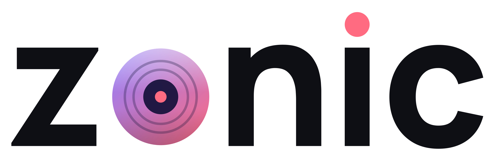

<div align="center">
  <picture>
    <source media="(prefers-color-scheme: dark)" srcset="web-app/brand/zonic-wordmark-on-dark.png">
    
  </picture>

  <p><strong>Your music, your space.</strong></p>
  <p>A fast, open-source music player for Android, Android TV, the web, and desktop.</p>

  [](https://github.com/imcomfyaaaaaa/zonic-music/releases/latest)
  [](https://github.com/imcomfyaaaaaa/zonic-music/actions)
  [](LICENSE)
</div>

## About Zonic

Zonic brings streaming, local music, radio, playlists, synchronized lyrics, and high-quality native playback into one consistent interface. The same TypeScript UI adapts across phones, desktops, cars, and ten-foot TV screens, while the Android app uses a native Flutter audio engine for background playback and media controls.

## Features

- Music-only search with live suggestions
- YouTube music and playlist importing
- Editable Zonic playlists and read-only linked playlists
- Local audio imports and offline downloads
- High-resolution album and artist artwork
- Synced, scrolling lyrics
- Native Android background playback and media notification
- Audio normalization, quality choices, and a five-band equalizer
- Smart Shuffle, queue controls, listening history, and recaps
- Radio Browser stations and favorites
- Android TV interface with secure five-digit Wi-Fi phone controls
- Automatic Android Auto / car layout
- Firebase accounts with private pairing profiles
- Desktop, responsive web, and 21 interface languages
- No ads and no subscription

## Download

Download the latest Android build from [Zonic Releases](https://github.com/imcomfyaaaaaa/zonic-music/releases/latest).

> Zonic is under active development. Back up important playlists before installing development builds.

## Development

Requirements: Node.js, Flutter, and the Android SDK.

```bash
flutter pub get
cd web-app
npm ci
npm run dev
```

Open `http://127.0.0.1:4317/` on the computer or use the computer's LAN address on a phone connected to the same Wi-Fi.

Build the Android APK:

```bash
cd web-app
npm run android:build
```

The APK is written to `build/app/outputs/flutter-apk/app-github-debug.apk`.

## Project layout

- `web-app/src/` — Zonic TypeScript/React interface and playback controller
- `lib/grove_main.dart` — native Android WebView shell
- `lib/grove/` — native playback, downloads, TV remote, and file integration
- `packages/grove_source_engine/` — shared music-source engine
- `android/` — production Android project

## Contributing

Bug reports and feature requests are welcome through [GitHub Issues](https://github.com/imcomfyaaaaaa/zonic-music/issues). See [CONTRIBUTING.md](CONTRIBUTING.md) before submitting code.

## Credits and license

Zonic is a GPLv3-or-later derivative of [Musify](https://github.com/gokadzev/Musify). Upstream copyright notices are retained in the source and Git history as required by the license. Zonic's interface, branding, cross-platform shell, TV controls, account integration, and related changes are maintained in this repository.

Zonic does not host or distribute copyrighted music. Content is provided by user files and third-party sources; users are responsible for following applicable laws and service terms.

See [LICENSE](LICENSE) for the complete GNU General Public License.
